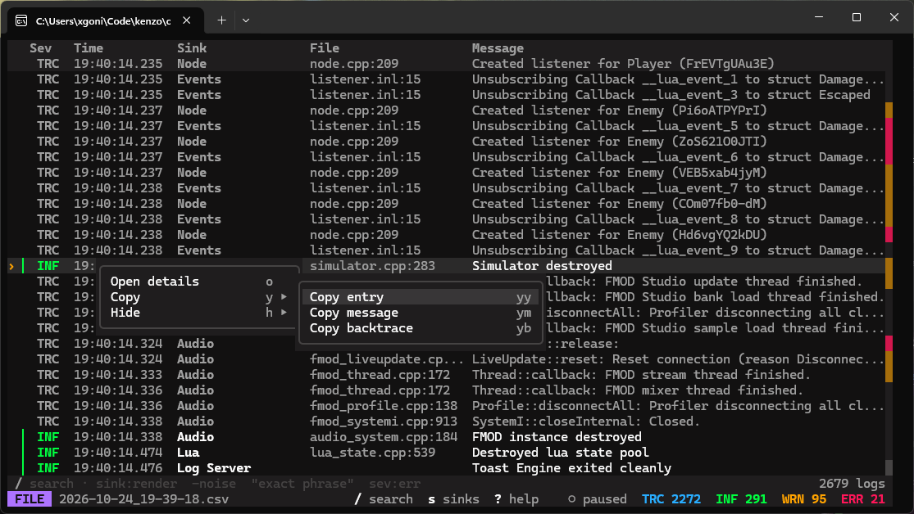
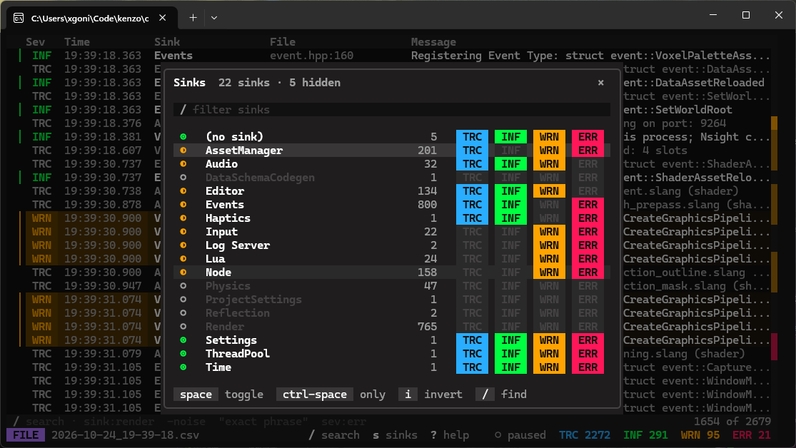
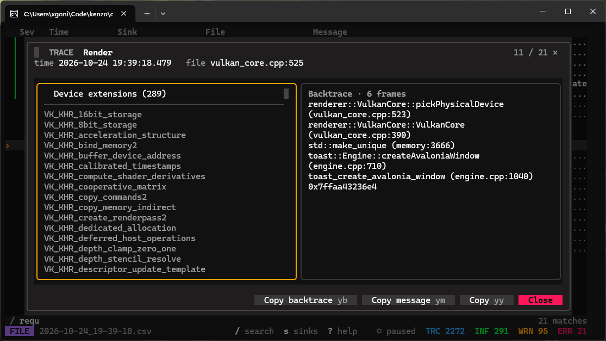

# kenzo

Terminal log viewer for the Toast Engine logging server

<video width="1114" height="628" controls>
  <source src="docs/main.mp4" type="video/mp4">
</video>

## Screenshots





## Install

You need CMake 3.24+, a C++23 compiler and [vcpkg](https://github.com/microsoft/vcpkg) with `VCPKG_ROOT`

```
git clone <repo url> kenzo
cd kenzo
cmake --preset win-release
cmake --build --preset win-release
```

Use `unix-release` on linux and macOS. The exe ends up in `out/<preset>/Release`

## Usage

```
kenzo                      menu, looks for a local server
kenzo --host 192.168.1.20  remote server
kenzo session.csv          saved session
```

Press `?` inside kenzo for the keys.
